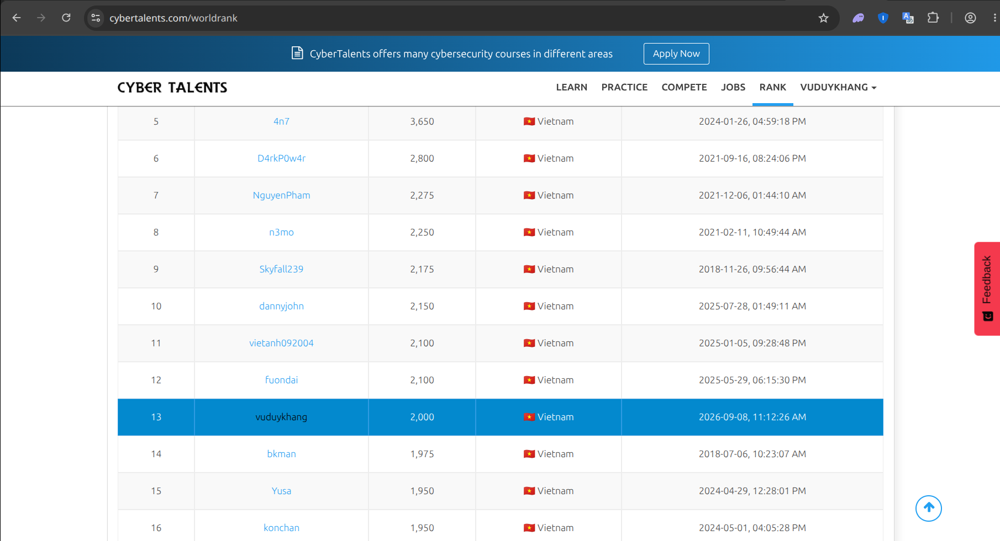

## Vũ Duy Khang

First-year Information Security student at PTIT Ho Chi Minh City, on the
blockchain track. I spend most of my time on smart contract security.

I have been around crypto since 2022, which is where the interest came from:
I wanted to understand why so many token contracts turn out to be traps.

### Smart contract security

**[smart-contract-security-lab](https://github.com/Vuduykhang2306/smart-contract-security-lab)**
— an audit carried out end to end. A tax token with **nine findings** in it, a
runnable Foundry PoC for each, a full report, the patched contract, and a retest
suite that replays every exploit against the patch. **23 tests**, CI on every
push. The report is
[here](https://github.com/Vuduykhang2306/smart-contract-security-lab/blob/main/reports/2026-09_MemeTax_audit-report.md);
the two findings worth your time are M-01 and M-02.

The ninth finding is the one I am least proud of and most glad about. My manual
pass missed it. It only turned up when I had to state, as a property, that every
ETH the contract has promised must be backed by its balance — and the fee swap
pays out the whole balance, dividend pool included.

**[A public review of a launchpad token template](https://github.com/Vuduykhang2306/smart-contract-security-lab/tree/main/reviews/2026-09_FatTokenV5)**
on Ethereum mainnet, using a dead token as the specimen. 8 findings, 7 proofs of
concept running against a mainnet fork, and the contract address published so
anyone can check the work. The useful result: every dangerous power in that
template is decided in the constructor and no function can switch any of them
back on, so a buyer can read five booleans and know their exposure permanently.

Scope was set by disclosure ethics — a near-dead contract only, and only findings
about what the deployer can do to holders. Nothing that hands a stranger somebody
else's funds.

**Two fuzzers and a control.** The four invariants run under Foundry and again
under [Echidna](https://github.com/Vuduykhang2306/smart-contract-security-lab/tree/main/test/echidna).
They agree, and neither caught anything the other missed — a negative result,
recorded as one. What the exercise did produce is the control: the same
properties pointed at the unpatched contract and *required* to fail. CI checks
all four outcomes by name. A green fuzzing run means either the code holds or
the harness never got there, and the output looks identical either way.

### Built on top of that

**[token-powers](https://github.com/Vuduykhang2306/token-powers)** -
[live](https://vuduykhang2306.github.io/token-powers/) - paste an ERC-20 from
mainnet and the page says what its deployer can still do to the people holding
it. It came out of the review above: the conclusion there was that a buyer can
read five booleans and know their exposure permanently, which is useless advice
unless you know which five.

It is built around a distinction the usual reading misses. An *owner power* is
something a privileged address can choose to do later, and renouncing ownership
kills it. A *baked-in mechanism* runs on every transfer with nobody calling
anything, and renouncing makes it permanent instead, because the setter that
could have switched it off is unreachable too. The same `owner() = 0xdead` is
good news for one and bad news for the other.

The part I like best is the sell simulation. Flags tell you what powers exist,
not whether a sell goes through right now, so the page asks the chain directly
with `eth_call` and a state override: fake the balance, try the transfer, see
whether the EVM reverts. Nothing signed, nothing broadcast. Same idea as the
fork PoCs in the audit repo, with the RPC doing what `deal()` does in Foundry.

Read-only throughout. It never requests a signature and never builds a
transaction.

### Writing

Longer notes on the work above, mostly about the parts I got wrong first, at
**[vuduykhang2306.github.io](https://vuduykhang2306.github.io)**:

- [Whose money is this?](https://vuduykhang2306.github.io/2026/10/09/whose-money-is-this.html)
  How H-04 got past two reads of the same function and fell out of a one-line
  invariant.
- [A green fuzzing run doesn't prove much](https://vuduykhang2306.github.io/2026/10/09/a-green-fuzzing-run.html)
  Two fuzzers, one result, and why the negative control is the part worth
  keeping.
- [The first drafts of three findings](https://vuduykhang2306.github.io/2026/10/09/first-drafts-of-three-findings.html)
  M-01, M-02 and L-01 were each wrong in a different way before they were right.
- [Renounced ownership is not a verdict](https://vuduykhang2306.github.io/2026/10/09/renounced-is-not-a-verdict.html)
  Owner powers versus baked-in mechanisms, from the FatTokenV5 review.

### Elsewhere

- **[nodex.io.vn](https://nodex.io.vn)** — an e-commerce platform I built and
  run on my own, with paying customers. Next.js, a REST API for customers who
  want to automate, a Linux VPS behind Cloudflare. Auditing contracts and never
  having to defend a live system of your own is a gap, so this is the other half.
- **[aquaoracle-app](https://github.com/Vuduykhang2306/aquaoracle-app)** and
  **[Esp32_AquaOracle_Programm](https://github.com/Vuduykhang2306/Esp32_AquaOracle_Programm)**
  — IoT water-quality monitoring for aquaculture: ESP32 sensor node, Supabase,
  a PatchTST forecasting model, Flutter app. Took it to the national final of
  the Vietnam Youth Innovation Contest 2026.
- CTF, mostly cryptography. Ranked
  **[13th in Vietnam on CyberTalents](https://cybertalents.com/members/vuduykhang/profile)**;
  captain of C0mt4m367 and of meobeo.

  The ranking is live on the profile above, and reproducible from
  [cybertalents.com/worldrank](https://cybertalents.com/worldrank) by filtering
  the country to Vietnam. Snapshot taken 15 September 2026:

  

### A note on the older repos here

Several of them used to have Supabase and Gemini keys committed in the source,
plus a Wi-Fi password in the ESP32 firmware. I found them while reviewing my own
account, rewrote the history to remove them, and moved every project to
gitignored config files. The keys were already dead by then, but that is luck,
not a process. Writeup of what I missed on the first pass is in
[the lab's notes](https://github.com/Vuduykhang2306/smart-contract-security-lab/blob/main/docs/notes.md).

Auditing other people's contracts and not auditing your own is not a position
you can hold for long.

### Contact

vuduykhang23062008@gmail.com — Ho Chi Minh City or remote.

Open to internships in smart contract security, Solidity development, or Web3
frontend. Those are the same interest from three sides: I would rather read the
contract than trust the ABI, and I would rather ship something and defend it
than only read other people's code.
